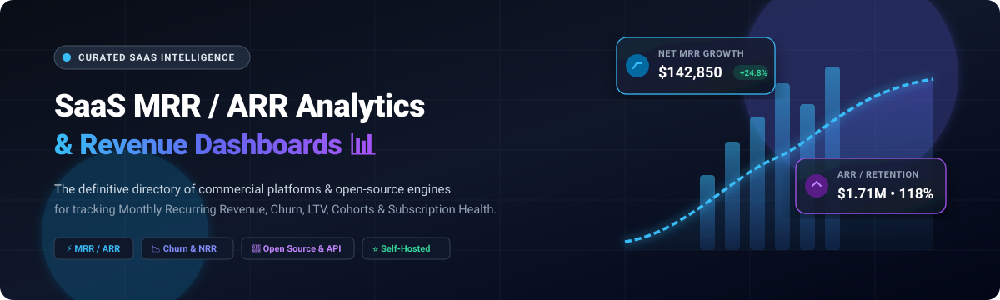

  

# 📊 Awesome SaaS MRR / ARR Analytics Dashboard

  
  
  
  
  
  

> 🌟 **The definitive, curated list of top SaaS MRR / ARR Analytics Dashboard platforms and tools** — featuring commercial cloud solutions and self-hosted open-source software engines for tracking Monthly Recurring Revenue (MRR), Annual Recurring Revenue (ARR), customer and revenue churn, Net Revenue Retention (NRR), Lifetime Value (LTV), and subscription health.
> 
> 🌟 *Star this repository if you find it helpful for your SaaS analytics and FinOps tech stack!* 🌟

---

## 📑 Table of Contents

- [🌐 Sector Overview & Market Dynamics](#-sector-overview--market-dynamics)
- [🟦 SaaS / Hosted Commercial Platforms](#-saas--hosted-commercial-platforms)
- [🟩 Open-Source Software & Engines](#-open-source-software--engines)
- [📊 Comparison Matrix at a Glance](#-comparison-matrix-at-a-glance)
- [🌟 Star History](#-star-history)
- [💖 Support & Sponsorship](#-support--sponsorship)
- [🤝 Contributing](#-contributing)
- [📄 License](#-license)

---

## 🌐 Sector Overview & Market Dynamics

The global recurring revenue management and subscription analytics market is estimated at **$18.5B to $24.1B** (within a broader **$500B+ global subscription economy**) and is projected to expand past **$42.6B by 2030** at an estimated CAGR of ~13%–16%. The industry exhibits a **bifurcated, hybrid structure**: it is **moderately concentrated at the high-end enterprise layer** where entrenched recurring billing infrastructure leaders (such as Stripe, Chargebee, and Zuora) command high customer lock-in, yet **highly fragmented across the mid-market and SME tiers** where specialized standalone analytics dashboards, AI-driven churn tools, and developer-centric open-source engines compete vigorously.

---

## 🟦 SaaS / Hosted Commercial Platforms

Below is a detailed breakdown of commercial, cloud-hosted SaaS MRR / ARR analytics dashboard platforms, sorted in descending order by company scale (valuation / annual revenue).

| 🏢 Product | 💰 Valuation / Company Scale | 🏷️ Starting Tier Pricing | 🎁 Free Tier Limit / Free Trial Plan | 🔍 Primary Focus & Key Capabilities |
| :--- | :--- | :--- | :--- | :--- |
| **[Stripe Sigma](https://stripe.com/sigma)** | **$159B Valuation** (~$5.1B+ Net Revenue) | **$10/mo** (billed annually for up to 250 charges) or $15/mo month-to-month | **30-day free trial** with full access to SQL query console, pre-built templates, and AI natural language SQL assistant | Stripe-native SQL analytics engine providing custom reporting across live payment, billing, and subscription datasets with zero ETL. |
| **[Chargebee](https://www.chargebee.com)** | **$3.5B Valuation** (~$100M+ ARR) | **$599/mo** (Performance plan billed annually; custom for Enterprise) | **Free Starter plan** covering up to your first **$250K in cumulative lifetime billing** (0.75% overage fee applies thereafter) | Subscription billing platform with built-in analytics dashboards tracking MRR movements, trial conversions, churn alerts, and deferred revenue. |
| **[ProfitWell Metrics](https://www.profitwell.com)** | **$200M+ Acquisition** (by Paddle; $1.4B valuation) | **$0/mo** (Core Metrics 100% free; monetizes via Retain/Recognized add-ons) | **Free forever plan with unlimited revenue & user tracking**; zero revenue caps across all business sizes | Accurate recurring revenue analytics with industry benchmarks from 15,000+ companies, churn trends, and automatic Clearbit enrichment. |
| **[Baremetrics](https://baremetrics.com)** | **$4M Acquisition** (~$1.5M ARR) | **$49/mo** (billed annually for $180K–$360K ARR; Growth tier at $189/mo) | **Free forever Launch plan** capped up to **$180,000 in tracked ARR**; includes 14-day free trial for paid tiers | 28+ turnkey SaaS metrics, visual cohort grids, cancellation insights, dunning recovery add-ons, and clean executive dashboards. |
| **[Databox](https://databox.com)** | **$8M+ ARR** (~$4.8M funding) | **$64/mo** (billed annually for Starter tier; Pro at $159/mo) | **Free forever plan** limited to **3 data sources, 1 active dashboard, 1 user, 10 custom metrics, and 50 AI credits/mo** | Business analytics dashboard connecting Stripe, HubSpot, Google Analytics, and 100+ integrations with AI-driven metric assistants. |
| **[ChartMogul](https://chartmogul.com)** | **$7.2M+ ARR** (~$3.7M funding) | **$57/mo** (billed annually for Starter plan; Pro tier at $99/mo) | **Free forever plan** capped up to **$10,000/mo in MRR ($120,000 ARR)** with unlimited seats and 1 billing data source | Standardized subscription analytics, revenue recognition, cohort retention tables, customer lifetime value, and integrated revenue CRM. |
| **[Geckoboard](https://www.geckoboard.com)** | **$3.5M–$7.2M ARR** (~$4.1M funding) | **$60/mo** (Essential plan billed annually for 1 dashboard & 1 editor) | **14-day free trial** with full feature access and no credit card required (no permanent free tier) | Real-time TV wallboards and team status displays pulling live MRR, churn, and revenue metrics into shared monitors, Slack, or Microsoft Teams. |
| **[FirstOfficer](https://www.firstofficer.io)** | **Bootstrapped** (Micro-SaaS acquired in 2020) | **$29/mo** (Hobby plan for up to 250 customers; Startup tier at $79/mo) | **Free basic metrics plan** for core Stripe analytics; 14-day free trial on paid FinOps cohort dashboards | Lightweight Stripe-centric financial metrics and FinOps cohort analysis built specifically for bootstrapped founders and micro-SaaS startups. |

---

## 🟩 Open-Source Software & Engines

A curated collection of self-hosted, open-source software repositories, CLI metric calculators, and analytics engines for SaaS MRR/ARR tracking. Repositories are ranked in descending order by GitHub community stars.

| 📦 Repository & Project | ⭐ GitHub_Stars | 🛠️ Tech Stack | 📜 License | 💡 Overview & Use Case |
| :--- | :---: | :--- | :--- | :--- |
| **[getlago/lago](https://github.com/getlago/lago)** |  | Go / Ruby / TypeScript | AGPL-3.0 | Open-source metering, billing infrastructure, and real-time revenue analytics dashboard tracking usage, consumption, MRR, and invoicing. |
| **[meteroid-oss/meteroid](https://github.com/meteroid-oss/meteroid)** |  | TypeScript / Node.js | MIT | Modern open-source pricing and billing infrastructure featuring subscription management, usage-based metrics, revenue analytics, and insights. |
| **[anonrig/socketkit](https://github.com/anonrig/socketkit)** |  | JavaScript / Node.js | MIT | Free, open-source self-hosted alternative to ChartMogul and Mixpanel for tracking user engagement, events, and recurring revenue metrics. |
| **[rameerez/profitable](https://github.com/rameerez/profitable)** |  | Ruby / Rails | MIT | Ruby gem and dashboard that calculates MRR, ARR, churn, LTV, ARPU, and business valuation directly from `pay`-powered Rails apps. |
| **[AlameerAshraf/tokentoll](https://github.com/AlameerAshraf/tokentoll)** |  | TypeScript / Python | MIT | Self-hostable billing and revenue telemetry engine for AI/SaaS products with real-time usage dashboards, Stripe adapter, and pricing plans. |
| **[progrmoiz/stripe-pulse](https://github.com/progrmoiz/stripe-pulse)** |  | Node.js / TypeScript | MIT | CLI tool calculating MRR, ARR, churn, LTV, NRR, Quick Ratio, and waterfall movements instantly from Stripe without SaaS subscriptions. |
| **[tanin47/book-of-revenue](https://github.com/tanin47/book-of-revenue)** |  | TypeScript / SQL | MIT | Open-source revenue recognition and financial analytics engine for Stripe and Metronome, built by ex-Stripe engineers for audit-ready ledgers. |
| **[mzkatk/saas-revenue-intelligence](https://github.com/mzkatk/saas-revenue-intelligence)** |  | Python / SQL | MIT | Reconstructs customer subscription lifecycles from raw snapshots, analyzing MRR growth, contraction, churn, retention cohorts, and ARPU. |
| **[vikkieessien/cohort-nrr-project](https://github.com/vikkieessien/cohort-nrr-project)** |  | dbt / DuckDB / SQL | MIT | End-to-end analytics engineering pipeline modeling Net Revenue Retention (NRR) and Gross Revenue Retention (GRR) cohorts from billing exports. |
| **[ult666666/saas-analytics-warehouse](https://github.com/ult666666/saas-analytics-warehouse)** |  | dbt / DuckDB / Python | MIT | Tested analytics warehouse modeling SaaS MRR waterfall movements, cohort retention, and channel-level unit economics with reproducible reports. |
| **[bhattsaurya16/SaaSDashboard](https://github.com/bhattsaurya16/SaaSDashboard)** |  | Python / Streamlit | MIT | AI-assisted SaaS analytics web dashboard providing MRR, churn rate, cohort retention, and automated Google Gemini executive summaries. |
| **[plusinfolab/cashier-saas-metrics](https://github.com/plusinfolab/cashier-saas-metrics)** |  | PHP / Laravel | MIT | Drop-in Laravel package for tracking MRR, churn, LTV, ARPU, and retention cohorts with multi-provider Stripe, Paddle, and LemonSqueezy drivers. |

---

## 📊 Comparison Matrix at a Glance

| Platform / Tool | 📂 Type | 💻 Architecture | 📈 MRR / ARR | 📉 Churn & NRR | 🖥️ Dashboard | 🏠 Self-Hosted | 🎯 Best Recommended For |
| :--- | :--- | :--- | :---: | :---: | :---: | :---: | :--- |
| **Stripe Sigma** | SaaS Hosted | Cloud SQL / AI | ✅ | ✅ | ✅ | ❌ | Teams embedded in Stripe seeking deep custom SQL reporting |
| **Chargebee** | SaaS Hosted | Cloud Native | ✅ | ✅ | ✅ | ❌ | Scaling subscription businesses needing billing & revenue recognition |
| **ProfitWell** | SaaS Hosted | Cloud Native | ✅ | ✅ | ✅ | ❌ | SaaS founders wanting 100% free analytics and retention benchmarks |
| **Baremetrics** | SaaS Hosted | Cloud Native | ✅ | ✅ | ✅ | ❌ | Clean out-of-the-box UI with dunning and churn cancellation surveys |
| **Databox** | SaaS Hosted | Multi-Source Cloud | ✅ | ✅ | ✅ | ❌ | Holistic business dashboards blending CRM, marketing, and MRR metrics |
| **ChartMogul** | SaaS Hosted | Cloud Native / CRM | ✅ | ✅ | ✅ | ❌ | Revenue consolidation, standardized metrics, and subscription CRM |
| **Geckoboard** | SaaS Hosted | TV / Real-Time Cloud | ✅ | ✅ | ✅ | ❌ | Office TV wallboards and team-wide KPI accountability displays |
| **FirstOfficer** | SaaS Hosted | Stripe Cloud | ✅ | ✅ | ✅ | ❌ | Micro-SaaS founders wanting lightweight Stripe cohort insights |
| **getlago/lago** | Open-Source | Docker / API | ✅ | ✅ | ✅ | ✅ | Full-scale open-source billing, metering, and revenue telemetry |
| **meteroid-oss/meteroid** | Open-Source | Node.js / Docker | ✅ | ✅ | ✅ | ✅ | Modern self-hosted pricing and usage-based subscription analytics |
| **anonrig/socketkit** | Open-Source | Node.js / Web | ✅ | ✅ | ✅ | ✅ | Open-source alternative to ChartMogul and Mixpanel |
| **rameerez/profitable** | Open-Source | Ruby on Rails Gem | ✅ | ✅ | ✅ | ✅ | Rails developers using the `pay` gem wanting zero-config MRR |
| **AlameerAshraf/tokentoll** | Open-Source | Node / Python | ✅ | ✅ | ✅ | ✅ | LLM / API pay-as-you-go usage metering and subscription revenue |
| **progrmoiz/stripe-pulse** | Open-Source | CLI / Node.js | ✅ | ✅ | ✅ (CLI) | ✅ | Developers wanting instant Stripe revenue metrics in the terminal |
| **tanin47/book-of-revenue** | Open-Source | TypeScript / SQL | ✅ | ✅ | ✅ | ✅ | Audit-proof ASC 606 / IFRS 15 revenue recognition and ledger checks |
| **mzkatk/saas-revenue-intelligence**| Open-Source | Python / SQL | ✅ | ✅ | ✅ | ✅ | Data scientists reconstructing MRR, ARPU, and retention lifecycles |
| **vikkieessien/cohort-nrr-project** | Open-Source | dbt / DuckDB | ✅ | ✅ | ✅ | ✅ | Data teams modeling cohort NRR/GRR via dbt data pipelines |
| **ult666666/saas-analytics-warehouse** | Open-Source | dbt / DuckDB | ✅ | ✅ | ✅ | ✅ | Full-stack reproducible warehouse modeling MRR waterfall movements |
| **bhattsaurya16/SaaSDashboard** | Open-Source | Streamlit / Python | ✅ | ✅ | ✅ | ✅ | Interactive Python web dashboard with automated Gemini AI insights |
| **plusinfolab/cashier-saas-metrics** | Open-Source | Laravel / Blade | ✅ | ✅ | ✅ | ✅ | Laravel applications utilizing Laravel Cashier for billing |

---

## 🌟 Star History

---

## 💖 Support & Sponsorship

Thank you so much for exploring and using this curated list! Maintaining and constantly updating this resource with new SaaS platforms, pricing models, and open-source metric engines takes continuous effort.

If this repository brought value to your project, startup, or analytics stack, please consider supporting the project:

- ⭐ **Star the repo** to help others discover it across GitHub.
- 🍴 **Fork and share** it with fellow founders, engineers, and data analysts.
- ☕ **Buy me a coffee / Sponsor the project:** Your generous support directly helps keep this and other curated lists actively maintained!

  
  &nbsp;&nbsp;
  

Visit the **[GitHub Sponsor Dashboard](https://github.com/sponsors/ishandutta2007)** to support ongoing development.

---

## 🤝 Contributing

Contributions, feature suggestions, and updates are very welcome! If you know of an awesome open-source or SaaS recurring revenue dashboard tool:

1. 🍴 Fork the repository.
2. 🌿 Create your feature branch (`git checkout -b feature/new-saas-metric-tool`).
3. 📝 Add the project in alphabetical or star-sorted order with clear descriptions and links.
4. 🚀 Commit your changes (`git commit -m 'Add awesome new tool'`).
5. 📬 Open a Pull Request for review!

---

## 📄 License

This repository is licensed under the [Creative Commons Zero v1.0 Universal](LICENSE) (CC0 1.0) Public Domain Dedication. Listed third-party tools, libraries, and trademarks belong to their respective copyright holders.
